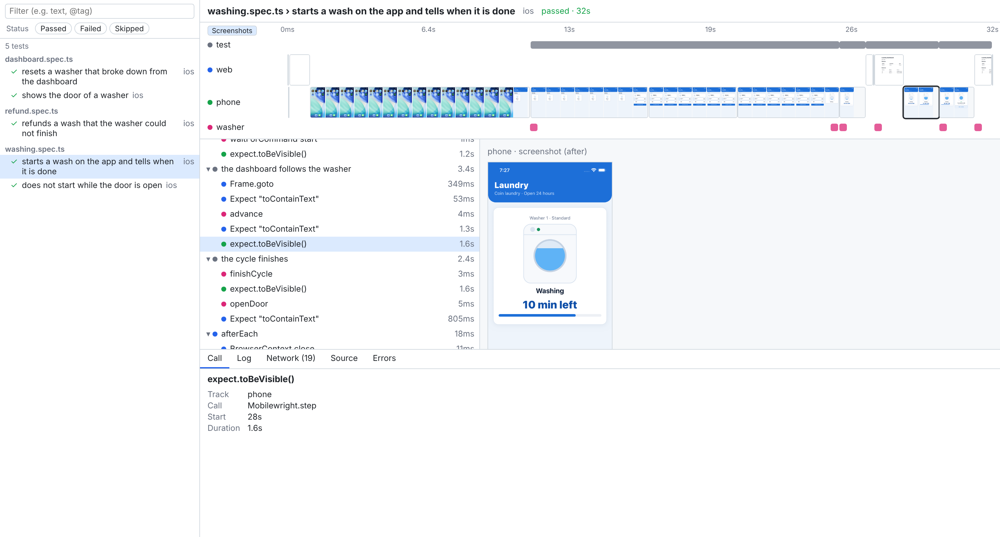

# Xwright

Xwright (pronounced "cross-wright") is an end-to-end testing framework that drives the web, mobile and other devices
from a single test, and records what every device did on one timeline.

It runs on Playwright Test, uses Playwright for the web and Mobilewright for mobile, and lets you add any other device
through adapters.

<picture>
  <source media="(prefers-color-scheme: dark)" srcset="./docs/images/trace-dark.png">
  
</picture>

The trace of [`examples/laundry`](./examples/laundry) on CI: a test pays and starts a wash on an iOS simulator, the
fake washer runs it, and the dashboard on the web follows.

> [!WARNING]
> Xwright is in early development, and its API may change between minor versions.

## Packages

| Package | Description |
| --- | --- |
| [`xwright`](./packages/xwright) | The CLI, the runner, `use()` and `step()`, and the adapter SDK |
| [`@xwright/playwright`](./packages/playwright) | The official adapter for the web, built on Playwright |
| [`@xwright/mobilewright`](./packages/mobilewright) | The official adapter for iOS and Android, built on Mobilewright |
| [`@xwright/ui`](./packages/ui) | The UI that shows the traces |

## Installation

Install `xwright` and the adapters of the devices to drive:

```sh
npm install --save-dev xwright @xwright/playwright @xwright/mobilewright
```

## Usage

Declare the devices in the projects of `xwright.config.ts`. Any option of Playwright Test other than `use` and
`webServer` goes as is.

```ts
import { mobilewright } from "@xwright/mobilewright";
import { playwright } from "@xwright/playwright";
import { defineConfig } from "xwright";

export default defineConfig({
  testDir: "tests",
  projects: [
    {
      name: "android",
      devices: {
        web: { adapter: playwright({ baseURL: "http://localhost:3000" }) },
        phone: { adapter: mobilewright({ platform: "android", bundleId: "com.example.app" }) },
      },
    },
  ],
});
```

Ask for the devices with `use()` at the top of a test file, and drive them one after another in a single test.

```ts
import type { MobilewrightHandle } from "@xwright/mobilewright";
import type { PlaywrightHandle } from "@xwright/playwright";
import { step, test, use } from "xwright";

declare module "xwright" {
  interface Devices {
    web: PlaywrightHandle;
    phone: MobilewrightHandle;
  }
}

const web = use("web");
const phone = use("phone");

test("signs in on the phone after signing up on the web", async () => {
  await step("sign up on the web", async () => {
    await web.page.goto("/signup");
    await web.page.getByRole("button", { name: "Sign up" }).click();
  });
  await phone.screen.getByRole("button", { name: "Sign in" }).tap();
  await phone.expect(phone.screen.getByText("Welcome")).toBeVisible();
});
```

Then run the tests with `xwright test`, which takes the options of `playwright test`. A test runs in every project
that has all the devices it uses, and is skipped in the others.

See [`examples/web-and-mobile`](./examples/web-and-mobile) for a complete example, and
[`examples/laundry`](./examples/laundry) for an app tested on the web, a phone and a fake washer.

### Trace

Set `trace` on a device to record what it did: `on`, `retain-on-failure` (kept only when the test failed),
`on-first-retry` or `off` (the default).

```ts
devices: { phone: { adapter: mobilewright({ platform: "android" }), trace: "retain-on-failure" } }
```

The trace of a test is written to `xwright-trace` in its output directory, and attached to the report as
`xwright-trace`:

- `trace.json`: the test, the devices and the result, with the clock to convert the times of the events.
- `test.ndjson`: the steps of `step()`, the output and the errors of the test.
- `<device>.ndjson` and `<device>/resources/`: the actions, snapshots, logs and communications of each device.

Passwords, tokens and other secrets are kept out of the traces: every event, `trace.json` and every text resource,
such as the bodies of the network, has them replaced with `[redacted]`, also as written in URLs and JSON. List the
secrets known beforehand in the configuration, and wrap the ones known only during a test with `secret()`. The values
of `Authorization`, `Proxy-Authorization`, `Cookie` and `Set-Cookie` headers are always left out.

```ts
export default defineConfig({
  redact: { secrets: [process.env.ADMIN_PASSWORD], headers: ["x-api-key"] },
});
```

```ts
import { secret } from "xwright";

const token = secret(await issueToken());
```

Screenshots are images, and are kept as they are; a secret shown on a screen, other than in a password field, stays
in its screenshots.

`xwright show-trace [path]` shows the traces at the path in the browser: a trace, its directory or a ZIP file of it, a
directory with traces such as `test-results` (the default), or a ZIP file with traces such as the `traces` artifact of
CI. The tests of several traces are listed as in `xwright test --ui`, with the same filters, to show the trace of each.
Without traces, it opens a ZIP file dropped on the page. A trace still being written is followed until its test ends.

`xwright test --ui` lists the tests in the browser to run them, all, filtered by words, statuses, projects and tags,
or one at a time, and shows the trace of each test as it runs. Each run is a new `xwright test` with the same arguments, so the changes to the tests are picked up.

`xwright export-trace` writes each trace under `test-results` (or the paths given) into a ZIP file next to it, such as
`xwright-trace.zip`, to upload from CI.

Events are appended as they happen, in the action model of Playwright's trace, with times of the monotonic clock of
the host. The creation and the disposal of devices go to `xwright-worker-<index>` in the output directory of the
project.

### Options for each worker

The options of an adapter can be a function that makes them for each worker, such as to give every worker running at
once its own account or port. It gets `parallelIndex`, from 0 to the number of workers - 1, which a worker recreated
after a failure keeps, and `workerIndex`, unique in the run.

```ts
web: {
  adapter: playwright(({ parallelIndex }) => ({
    baseURL: "http://localhost:3000",
    httpCredentials: { username: `user${parallelIndex}`, password: process.env.PASSWORD! },
  })),
},
```

`createOnce` and `disposeOnce` of an adapter run in the runner, outside the workers, and get the options for the
indices 0.

### Official adapters

- `playwright(options)` launches a browser per worker. Every test gets a fresh browser context and page, or
  `isolation: "file"` shares them in a file. It takes `browserName`, `launchOptions` and the options of a browser
  context such as `baseURL`. The handle is `{ browser, context, page, expect }`. When traced, every call of
  Playwright's API is an action, with the logs, DOM snapshots, screenshots, console messages and network of
  Playwright's live trace.
- `mobilewright(options)` borrows a device from Mobilewright's device pool for each file, installs `installApps` once
  per device, and relaunches `bundleId` before each test. It takes the options of Mobilewright, such as `platform`
  and `driver`. The handle is `{ device, screen, expect }`. When traced, each operation such as a tap is an action,
  with a screenshot after it (`screenshots`), and the view hierarchy is recorded when a test failed (`viewTree`).

### Adapters

Any other device comes in through an adapter, written outside this repository with `defineAdapter`. Every hook is
optional except `create`, and the hooks run outside the user's. `createOnce` and `disposeOnce` run once in the whole
run, in the runner, and the value `createOnce` returns reaches every worker as `ctx.shared`.

```ts
import { defineAdapter } from "xwright";

export const band = defineAdapter<{ address: string }, BandHandle>({
  name: "my-band",
  create: ({ options }) => new BandHandle(options.address),  // once per worker; what the handle points to
  beforeAll: (band) => band.connect(),  // for each file
  beforeEach: (band) => band.reset(),  // for each test
  onFailure: (band, { testInfo }) => band.dumpLogs(testInfo),  // when a test failed
  afterAll: (band) => band.disconnect(),
  dispose: (band) => band.close(),
});
```

An adapter records what the device does on its track through `ctx.trace`, which every hook receives:

```ts
create: ({ trace }) => new BandHandle({
  // Wrap each command of the driver, so that it shows up as an action on the timeline.
  send: (command) => trace.action({ title: command.name, params: command.args }, () => driver.send(command)),
}),
```

[`examples/laundry/fake-washer`](./examples/laundry/fake-washer) is a complete adapter of a fake device.

## Development

```sh
pnpm install
pnpm build
pnpm check
pnpm test
```

## License

Licensed under the [Apache License, Version 2.0](./LICENSE).
